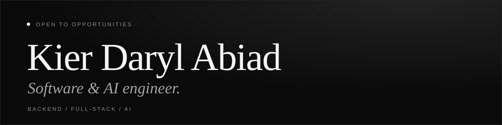

  <picture>
    <source media="(prefers-color-scheme: light)" srcset="assets/banner-light.svg">
    
  </picture>

  <a href="https://kier-abiad.vercel.app"><b>Portfolio</b></a> &nbsp;·&nbsp;
  <a href="https://kier-abiad.vercel.app/Abiad_KierDaryl_RESUME.pdf"><b>Résumé</b></a> &nbsp;·&nbsp;
  <a href="https://www.linkedin.com/in/kier-abiad/"><b>LinkedIn</b></a> &nbsp;·&nbsp;
  <a href="mailto:kier.abiad@gmail.com"><b>Email</b></a>

---

## About

I'm a software engineer in Imus City, Cavite, Philippines, with hands-on experience in scalable backend systems, full-stack applications, and AI-powered tools. I work with Python, Django, React, and Docker to turn real problems into production-ready solutions, and I'm especially interested in cloud infrastructure and machine learning.

BS Computer Science, Technological Institute of the Philippines (Manila), class of 2025.

## Experience

| Role | Where | When |
| --- | --- | --- |
| AI Software Engineer | Mind You | May 2025 – Sep 2026 |
| Developer Intern | Mind You | Feb – May 2026 |
| IT Infrastructure Security Intern | Malayan Insurance Co., Inc. | May – Aug 2024 |

Highlights: built a Slack-to-Google Chat migration tool that moved 40+ channel conversation logs with 100% data integrity, and a Django + Docker backend from scratch that brought environment-inconsistency incidents to zero.

## Selected work

- **[Mock_Logs](https://github.com/kierabiad/Mock_Logs)** — Django-based logging and analytics system using Docker, PostgreSQL, Redis, and Celery for asynchronous processing and performance optimization.
- **[kdportfolio](https://github.com/kierabiad/kdportfolio)** — My portfolio, in monochrome. React, Vite, and Tailwind CSS, live at [kier-abiad.vercel.app](https://kier-abiad.vercel.app).

## Toolkit

| | |
| --- | --- |
| **Languages** | Python · JavaScript · Java · C · C++ · C# · SQL |
| **Web** | Django · React · Next.js · Laravel · Node.js · Celery · REST APIs · HTML / CSS |
| **Databases** | PostgreSQL · MySQL · Redis · Firebase · SQLite |
| **Cloud & DevOps** | Docker · Git / GitHub · Vercel · Railway · AWS (Foundations) |
| **AI & data** | TensorFlow · OpenCV · scikit-learn · NumPy · Pandas · Matplotlib |
| **AI tooling** | MCP · OpenRouter · Qdrant · GitHub Copilot · Google Colab |

## Certifications

- Introduction to Machine Learning — Microsoft
- Generative AI Foundation — WPH Digital
- AWS Concepts & Cloud Computing — DataCamp
- Cloud Architecture Foundation — WPH Digital
- Java Programming Masterclass — Udemy
- .NET & C# Bootcamp — WPH Digital
- Application Security — WPH Digital

## Currently

- **Learning:** distributed systems (partitioning strategies) and multi-agent pipelines with LangChain and AutoGen
- **Building:** local, vector-optimized log-parsing microservices
- **Exploring:** production cluster management

---

  Open to roles, collaborations, and good technical conversations — <a href="mailto:kier.abiad@gmail.com">say hello</a>.

